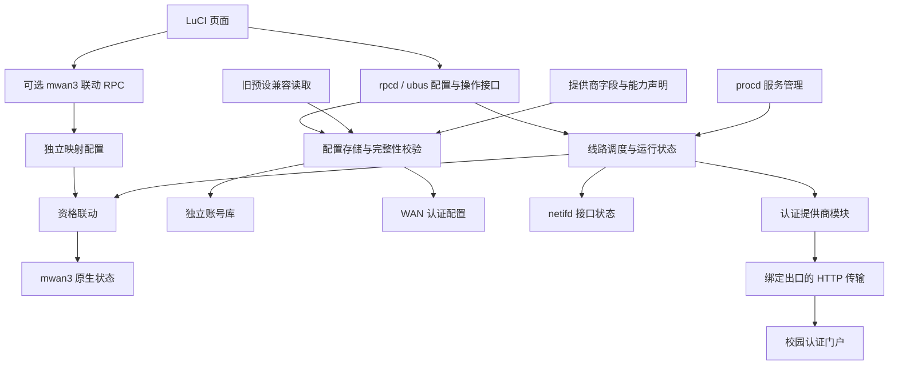
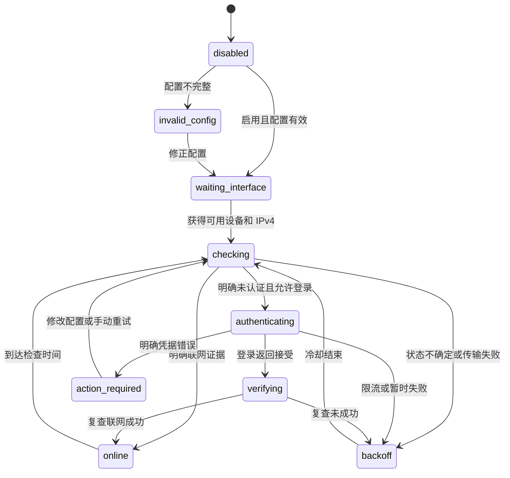

# CampusLink 框架设计 v1

状态：框架由 [CL-01](dev-plan/phase-01.md)至[CL-03](dev-plan/phase-03.md)承接开发与设备测试；[CL-UI-01](tasks/ui-simplification.md)交付 0.2.0，[CL-UI-02](tasks/plugin-settings.md)已交付 0.3.0 公共设置并完成独立复核及正式设备升级/迁移/服务重启验收。用户授权完整开发及设备测试，并要求避免不必要的加密/保护工程。

## 目标与边界

CampusLink 面向使用 OpenWrt 的校园网用户：保存账号，为已有 WAN 选择登录系统和认证服务器，按用户设置的周期检查状态，并在确认未认证时重新登录。CL-UI-03 已在当前工作树移除学校入口；后端预设读取仅为旧配置兼容保留，这项增量已随 LuCI 0.4.0 在原设备部署。
首个适配器为现有脚本对应的 Dr.COM HTTP 门户；Dr.COM 的其他协议实现不能仅因厂商名称相同就复用它。
当前 Cudy TR3000 四路虚拟 WAN 是试用场景，首版上限为 64 个账号、32 条线路和 256 KiB 配置。创建 macvlan、修改路由表、配置 mwan3 和代理由设备部署任务负责；本插件消费已有 netifd 接口。

可选独立 addon `campuslink-mwan3` 的功能名为“mwan3 联动”。设备已从 [MWAN-05](tasks/campuslink-mwan3.md) 固定四路版本升级为 addon 0.2.0；[CL-MWAN-06](tasks/mwan3-mappings.md) 在当前工作树新增独立配置、get/save RPC 与最多 32 条来源接口 → mwan3 接口映射。认证核心/凭据/公共 API 不改，LuCI ACL 只增加已有管理员对 addon 的 get/save。addon 读取原 public status 和已有 mwan3 配置，依据两端设备/IP、完成时间和物理事件控制原生 connected/disconnected；不写 mwan3 UCI 或全局重载。每对映射的激活代号持久化在 addon 配置中，未改变的映射沿用证据，新激活的映射使旧资格失效。运行缓存及事件只写 /var/run。IPv4、mwan3-nft 及未知/失联无年龄上限的边界保留，停用保留成员状态，详细说明见 [addon](../packages/campuslink-mwan3/README.md)。此增量的原生运行与实际分流已在原设备验证，见 [0.4.0](testing/0.4.0.md)。

待实现增量 D-20261014-23 / [CL-MWAN-07](tasks/mwan3-unknown-expiry.md)：在同轮受管集合中结合最后一次明确联网成功及证据年龄，有其他新鲜健康线路时排除长期未知线路；全体未知保留当时实际资格并提示，旧结果不恢复已退出成员，明确物理/未认证负面证据优先。消费既有检查，不另增加高频请求；主动降频/账号暂停和联网资格分别判断。当前 addon 0.2.0 仍是上述无年龄上限实现，本次仅确认目标。

## 模块与依赖



| 模块 | 职责 | 不承担的职责 |
| --- | --- | --- |
| LuCI | 表单、状态、脱敏日志、手动操作 | 直接读取密码文件、执行登录脚本 |
| RPC / 存储 | 权限、字段与引用校验、配置版本、凭据写入 | 提供通用 shell 或任意文件接口 |
| 调度器 | 接口检查、定时任务、锁、冷却、状态转换 | 理解特定学校的返回码 |
| 提供商 | 声明字段，检查认证、登录及解释错误 | 修改路由、防火墙、全局调度 |
| 旧学校预设兼容 | 加载旧配置继承的默认值，页面保存时显式保留 | 新配置入口、账号、密码或可执行代码 |
| HTTP 传输 | 源设备/IP 约束、编码、超时、输出限制 | 选择账号、判断业务成功 |
| mwan3 联动 | 显式接口映射、绑定复核、成员资格与状态 | 账号认证、创建网口、修改权重/策略或原生跟踪 |

技术选型属于本轮设计选择：原生 LuCI JavaScript，rpcd/ubus，ucode 后台，procd 管理服务；ucode 的 uloop 驱动定时器与有界子进程。不依赖路由器安装 Python 或 Node。实施先验证目标固件的 ucode、rpcd 模块和 curl 能力，不能从本机文档检查推断运行兼容性。

## 数据模型与配置

| 对象 | 关键字段 | 引用与约束 |
| --- | --- | --- |
| provider | ID、凭据类型、账号/线路字段、能力 | 注册的模块 ID 对应安装包内代码 |
| school（兼容） | ID、名称、provider ID、默认参数、验证状态 | 仅旧配置继承，页面保存后解除引用 |
| account | 稳定 ID、别名、凭据类型、用户名、密码 | 独立账号库，多条线路可以引用 |
| settings | 公共 provider、覆盖参数、检查/重试设置；school 保留兼容空值 | schema 2 的校园认证和周期唯一来源 |
| connection | 稳定 ID、逻辑接口、account、线路级覆盖参数、enabled、auto_login | 同一逻辑接口至多一条启用配置；线路启用与自动登录分开；运行时由 effective_connection 合并公共设置 |
| runtime | 当前设备/IP、状态、原因码、最后检查、下次操作、任务/配置版本 | 运行内存和 `/var/run/campuslink`，不反复写 flash |

新配置的线路有效参数 = 提供商默认值 → 用户公共参数 → 线路参数；后者优先。旧配置仍在用户覆盖前合并旧学校预设，保存时将有效公共参数及继承的线路参数转为显式配置并清空 school。必须通过字段类型、范围、枚举和必填校验。
选择登录系统后只填写服务器及检查周期；协议固定值不直接平铺，少见覆盖参数放高级设置。0.1.0 历史基线仅生成全部声明字段并填默认值；0.2.0 已交付服务器派生和基础/高级字段划分，见 [CL-UI-01](tasks/ui-simplification.md)及[实际页面证据](testing/0.2.0.md)。
页面不再选择学校或恢复学校预设；恢复默认参数仅在草稿中恢复提供商默认值，没有默认服务器时需重新填写。更换登录系统清除旧公共参数及不兼容线路参数，重新校验账号凭据类型；保存前展示需要补充的字段。
运营商选项和手机/电脑终端模式属于某个提供商的参数，不冒充认证提供商。自动得到的源 IP、设备名来自 netifd，不作为学校预设中的固定值。

- `/etc/campuslink/config.json`：单份账号、线路及全局设置；线路引用账号 ID，root 所有、权限 0600。普通本地明文配置，不引入额外加密或用户体系。
- 提供商声明与旧学校兼容 metadata：安装包内只读 JSON，格式见 [提供商契约](contracts/provider-v1.md)。首版不提供网页上传代码或联网下载任意插件。

账号读取接口仅返回 ID、别名、用户名、凭据类型和 `password_set`。编辑时不返回原密码；省略密码字段表示保留，空白表示保留；首版密码必填，不提供清空密码的动作。
被线路引用的账号不能直接删除，返回 `account_in_use` 并列出引用线路。多 WAN 共用账号不代表学校允许多会话。
凭据配置不开放通用 UCI 读取 ACL；页面上的密码遮蔽不足以形成权限边界。授权 RPC 只暴露必要的结构化动作。
存储写入串行执行，先校验全部引用，再以临时文件和 atomic rename 保存一份 JSON；不引入跨文件事务。读取/写入统一走插件 RPC，使用配置版本拒绝过时页面覆盖新配置。
每次有效修改递增 `generation`，账号变化使所有引用线路的旧任务结果失效。

## 每路调度与状态



任一启用状态发现设备/IP 不可用时进入 `waiting_interface`；禁用进入 `disabled`；参数失效进入 `invalid_config`。状态机画出的箭头只描述正常主流程。
检查结果统一为 `online / unauthenticated / indeterminate`。已知门户证据才判未认证；普通 200、未知 302、DNS 错误或超时不能证明在线，也不能据此认定密码错误并反复登录。
登录被接受仍需复查网络，不能把认证 HTTP 请求成功当成已联网。当前实现中明确的密码错误使该线路进入 `action_required`，停止自动登录直到用户修正或主动重试。D-20261014-21 / [CL-CORE-01](tasks/concurrency-account-fuse.md)已确认待实现的目标为账号级熔断：可信账号级拒绝停止同账号全部引用线路的自动认证，修正对应账号或显式恢复处理；DNS/超时及未知响应不能误判为账号拒绝，重启/无关保存/IP 变化不应静默解锁。实际核心尚未实现这项增量。
`enabled=false` 停止该线路任务；`enabled=true, auto_login=false` 允许检查和手动登录，但确认未认证后只提示 `login_required`，不自动发出账号请求。试用者先启用线路做手动验证，成功后再打开自动登录。手动动作不能解除提供商冷却。
启动、接口就绪、IP 变化、配置变化触发检查；每秒回读接口，周期检查作为补充，不排队叠加。
每条线路最多一个在途操作，当前全局并发 2；D-20261014-21 已确认目标上限 4、保留互斥/冷却且不新增设置项，待 CL-CORE-01 实现。周期从操作结束后计算，慢请求不叠加；手动操作遇到在途任务返回现有任务 ID。
异步任务携带配置 generation 和开始时的设备/IP；结束再核对，过期结果丢弃。禁用、服务停止时取消任务并清理临时文件；重启不沿用之前的“已在线”判断。

已实现并用于设备试用的初值：

| 设置 | 默认值 | 首版可选范围 |
| --- | --- | --- |
| 每条线路检查间隔 | 60 秒 | 10–3600 秒 |
| 登录重试基础间隔 | 30 秒 | 10–600 秒 |
| 退避上限 | 600 秒 | 60–3600 秒，不能小于基础间隔 |
| 全局并发任务 | 2 | 首版固定 2 |

暂时失败按 `min(基础间隔 × 2^(连续失败次数−1), 上限)` 退避，成功后重置。提供商可信的 `retry_after_s` 构成额外最早重试限制；手动登录也受限流冷却约束。
冷却用单调时钟，页面时间用墙钟。状态不确定时退避后再检查；只有确认未认证才进入登录。
首版“保活”首先实现状态检查和重新登录。协议专用 heartbeat 只有提供商明确支持且验证后才启用，不能为没有该接口的学校伪造心跳。

## 请求必须走选中的 WAN

操作开始回读 netifd 的接口 up、L3 设备和 IPv4；每秒监测变化并取消任务，结束再核对。HTTP 始终绑定该设备/IP，缺失时等待，不使用主路由的 IP 代替。
传输层要求同时绑定设备和源 IP；优先使用 curl 的 `ifhost!设备!IP`（需要 libcurl 8.9.0 或更新），并验证目标构建支持。能力不满足或无法绑定返回 `binding_unavailable`，不静默退回默认 WAN。
设备绑定不能替代正确的系统路由；试用前由部署任务提供每路可用的源地址路由和返回路径。
首个学校的认证地址是 IP 字面量。域名探测使用路由器系统 DNS，不额外搭建每 WAN 的解析服务；实际 HTTP 连接仍绑定设备/IP，保留 TLS 校验。DNS 查询不保证独立出口，这项简化不改变认证请求的源设备/IP 约束。
传输限定 HTTP/HTTPS、连接/总超时、响应字节数和跳转次数；认证请求不自动把凭据带到其他主机。禁用环境代理和默认 curlrc，防止旁路所选 WAN。
参数逐字段 URL 编码，不拼接未编码查询串。目标旧版 ucode 的 popen 只接受字符串；命令仅含固定程序和校验过的私有路径，用户值只进入 curl 配置。
密码不放进 argv、环境、返回消息或日志；由 root 私有临时配置/输入通道传递，按 curl 配置格式转义并在正常、取消、异常路径清理。实施需核验进程列表、文件权限和失败清理，ucode 子进程 I/O 方案先做小型运行原型。
提供商只通过统一传输 API 发送请求，不能自行调用不绑定接口的 curl。

## RPC 与页面

| ubus campuslink | 行为 |
| --- | --- |
| get | 无密码配置、元信息、状态、事件和接口列表 |
| save(config, expected_generation) | 整体校验、保留省略的密码并原子保存 |
| action(id, operation) | check/login/logout/enable/disable；耗时操作返回任务 ID |

写操作需要 LuCI 管理写权限，读操作独立授权；后端始终再校验。返回结构包含稳定 `reason_code`、脱敏消息和任务 ID；耗时操作立即返回任务 ID，页面轮询状态。
不支持提供任意 shell、路径、ubus 对象名或完整含密 URL。退出仅在提供商支持时展示，成功退出后暂停该线路自动登录；禁用仅停止后台任务，不等同门户退出。
只读事件使用全局 200 条内存缓冲，服务器消息脱敏后最多 240 字节，0.2.0 日志标签展示最近 50 条。诊断输出不包含密码、令牌、Cookie 或带凭据的请求。

采用原生 LuCI 控件，总览/登录配置/账号/插件设置/mwan3 联动/日志六个标签、紧凑列表和局部编辑。插件设置统一登录系统/服务器/检查周期，高级包含公共 URL/探测/重试；WAN 弹窗仅接口、账号、终端和开关，名称为可选高级项。mwan3 联动单独保存开关和接口映射，成员与实际状态只读，缺 addon 不影响认证页面。账号仍独立复用，新增线路可内联新增账号。两类设置草稿跨标签保留；恢复回到最新保存值，冲突保留草稿，认证/联动的旧轮询分别不能回退已接受的 generation。联动状态及成员更新不覆盖输入；高级无效字段校验前展开，保存中防重复提交。

提供商字段可声明 advanced、capability 和 scope；scope 默认 global，terminal_mode/scenario 为 connection，后台强制作用域。resolve_params 在默认/旧学校兼容值/公共/线路覆盖合并后派生端点并再次校验；解析器按来源归一化旧标准学校 URL，显式及非标准 URL 保留。同类 schema 1 配置在内存迁移，首次成功保存才落盘 schema 2；异构旧配置继续按原规则运行，管理员选择公共配置后才统一。切换系统清除旧公共覆盖，旧包回退须恢复原配置。契约见 [provider-v1](contracts/provider-v1.md)，0.3.0 设备基线见 [验证记录](testing/0.3.0.md)，学校入口移除见 [CL-UI-03](tasks/school-removal-mwan3-naming.md)。

扩展贡献通过仓库提交认证模块、字段声明及脱敏配置说明，不再新增学校选择目录，不在路由器上运行陌生上传脚本。新线路默认禁用且自动登录关闭这一现有行为保留，简化展示不自行改变后台调度契约。

## 包与目录边界

```text
packages/campuslink/
  Makefile
  files/etc/init.d/campuslink
  files/usr/share/campuslink/{providers,schools}/
  files/usr/share/campuslink/daemon.uc
packages/luci-app-campuslink/
  Makefile
  htdocs/luci-static/resources/view/campuslink/
  root/usr/share/luci/menu.d/luci-app-campuslink.json
  root/usr/share/rpcd/acl.d/luci-app-campuslink.json
```

后台进程直接发布 typed ubus 接口，由 rpcd session ACL 授权 LuCI 访问，省去额外 RPC 转发进程。后台包 `campuslink` 与界面包 `luci-app-campuslink` 分开，前者可以独立运行。
使用目标固件匹配的依赖版本构建。官方 OpenWrt 25.12 使用 APK，但本机 Kwrt 25.12-SNAPSHOT 实测仍使用 OPKG，首轮交付 IPK；官方 APK 支持需另验。
升级保留 JSON 配置、检测 schema 版本；不支持的版本停止认证并解释原因。卸载停止服务、清除运行临时文件并保留账号配置，明确提供用户主动清除方法，不能在升级中误删账号。

## 开发与试用承接

先实现 mock 提供商、账号/线路配置、调度状态机、脱敏 RPC 和原生 LuCI；用假凭据验证完整流程，不需要学校真实密码。
再用脱敏的门户响应样本实现 Dr.COM HTTP 的严格解析和错误映射，构建纯脚本 IPK；SDK Makefile 作为其他环境构建入口。最后由试用者逐路启用，先单 WAN，再验证两路/四路并发、出口归属、掉线、限流和回滚。
发出试用包需附构建目标、依赖、安装/卸载、恢复步骤和测试清单；真实密码仅由试用者在本地填入。旧安装脚本不作为新包迁移工具。
具体凭据保存、ACL、日志与出口绑定实现会影响秘密泄露或错误账号请求；最初框架文档为 R0，0.3.0 公共配置迁移及全线认证目标按 R2 验证和独立审查，详见 CL-UI-02。
未知项仅影响学校适配/实测：学校正式名称、当前认证地址与返回码含义、在线检查证据、会话限制、真实参数及目标 SDK。无需等待这些信息才设计通用框架。

## 当前设备的可选代理共存

[PROXY-01](tasks/proxy-mwan3.md)只在设备部署层配置 Nikki/Mihomo，不改变 CampusLink 核心、账号及 RPC。代理启用时 LAN TCP/UDP 由 TPROXY 接管，代理出站 socket 的 0x10000 标记进入 mwan3 原生 balanced；客户端接管标记与成员标记分开，避免前半段重复占用均衡序列。CampusLink 的接口/源地址绑定请求不接管，成员资格继续由可选联动服务控制。Nikki 控制 API 在 [PROXY-02](tasks/nikki-panel.md)改为仅 LAN 地址监听及强随机密钥，原生按钮兼容本机面板 hash 路由；LAN 显式代理端口仅允许当前 LAN。当前进程托管修正及本机 DNS redirect 的单项变化、恢复与验证边界见任务。

[NET-07](tasks/lan-management.md)限定当前设备管理入口：uhttpd 仅 LAN IPv4 地址监听 HTTP/HTTPS；Dropbear 通过 DirectInterface=lan 直接绑定 br-lan，WAN 防火墙拒绝保留。普通 Interface 地址绑定在此固件读取为空，未保留该回退通配方案。当前 Nikki 按用户决定关闭，以上代理路径是已验证的可选能力；校园四路仍由原策略与联动管理。

## 官方依据

- [LuCI 示例结构](https://github.com/openwrt/luci/blob/master/applications/luci-app-example/structure.md)：JavaScript 页面、menu、rpcd ACL 与 ucode 示例。
- [procd 官方脚本接口](https://github.com/openwrt/openwrt/blob/main/package/system/procd/files/procd.sh)：服务参数与配置/接口触发入口。
- [ucode uloop](https://ucode-lang.org/module-uloop.html)：定时器和子进程接口；实际异步 I/O 与取消行为仍需目标环境原型验证。
- [curl 官方手册](https://curl.se/docs/manpage.html)：接口/源地址绑定、参数编码、配置输入和超时。
- [OpenWrt 软件包说明](https://openwrt.org/packages/start)：APK/OPKG 版本边界。

## WAN 出口诊断（CL-NET-01）

LuCI 0.4.1 自带独立 rpcd exec plugin `campuslink.diagnostics`，get 只读 /var/run 缓存，query 由子进程调用既有绑定 transport 及固定 HTTPS IPIP JSON 端点，前后核对接口与配置。全局 flock、每接口 60 秒冷却、5 分钟结果年龄；数据仅含接口/绑定、查询 IPv4/时间/错误，不含账号。无需 mwan3 addon，不占认证 worker、不调用认证 action 或修改 UCI/选路。首次注册需 rpcd restart，已有对象更新只需 reload；详见 [0.4.1](testing/0.4.1.md)。
